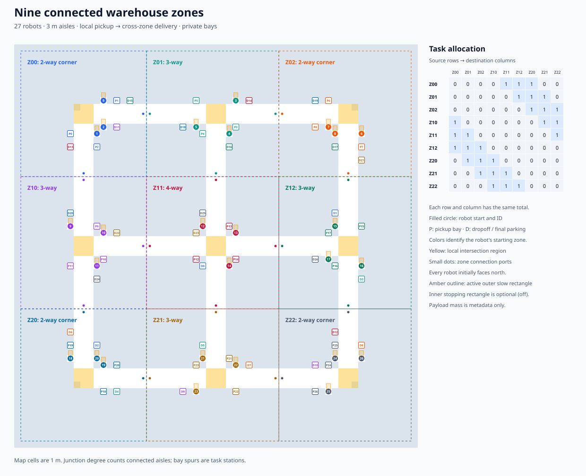

# Warehouse congestion: prediction and planning baselines

A research testbed for asking whether forecasts of slow robot traffic can improve warehouse planning. It contains the native LSMART simulator, safety-field models, seven traffic predictors, and controllers that propose and evaluate alternative plans.

The default floor has nine connected zones and 27, 54 or 81 robots carrying finite pickup–delivery tasks. The experiments distinguish **prediction accuracy** from **actual deliveries, completion times and computation cost**.



## Start here

Use Python 3.12 and a running Docker engine. Native simulation uses `linux/amd64`; ARM machines need Docker's x86 emulation. The Python predictors run on the host CPU. No Amazon service, proprietary model, account or server is required.

```bash
python3.12 -m venv .venv
.venv/bin/python -m pip install -r requirements.txt

# Linux CPU installation:
.venv/bin/python -m pip install -r requirements-ml.txt \
  --index-url https://download.pytorch.org/whl/cpu
# macOS: use the same command without --index-url.

make smoke
make test
make native
make route-smoke
```

`make smoke` checks the Python pipeline without Docker or saved recordings. `make native` builds the simulator and runs native regressions. `make route-smoke` runs all three route-selection baselines for a short 27-robot simulation. It checks integration, not predictor quality.

`make doctor` checks dependencies and Docker connectivity. For the versions used to validate this copy, add `-c constraints-tested.txt` to the pip installation commands.

Docker follows your active context or `DOCKER_HOST`. If a remote engine cannot mount this checkout, run the commands on the engine's host. The first image build downloads the pinned public LSMART base and checksum-verified ARGoS development package.

## Experiments

Run these from the repository root after setup and the native build. Commands, inputs, outputs and evaluation definitions are in [the experiment guide](docs/EXPERIMENTS.md).

| Study | Command | What it compares |
|---|---|---|
| Predictor benchmark | `make predictors` | Zero, persistence, kinematic/plan projection, joint rollout, ridge, ConvLSTM and residual ConvLSTM |
| Fleet scaling | `make fleet` | 27/54/81 robots and both safety rules |
| Forecasts on larger fleets | `make fleet-evaluate` | Frozen predictors evaluated on the fleet recordings |
| Route-cost search | `make route-search STUDY=route_run_1` | Ordinary planning, nominal selection and rollout selection |
| Safety ablation | `make safety STUDY=safety_run_1` | No safety rule, Safety rule 1 and Safety rule 2 |
| Entry-gate baselines | `make gates STUDY=gate_run_1` | No intervention, reactive gating and forecast gating |
| Search over admission holds | `make search-gates STUDY=hold_run_1` | No intervention and candidate hold policies |

Full experiments generate recordings and train models locally; large datasets and checkpoints are not bundled. Use a fresh study name for each new configuration. Native runs are serial so they do not compete for the planner's CPU-time budget. The complete training and evaluation pipeline takes substantially longer than the smoke checks.

## What the methods do

The planner is PBS with a native fallback. Safety fields act during execution:

- **No safety rule:** disable field-induced slowing; bodies and action dependencies remain.
- **Safety rule 1:** another robot's body enters the outer safety field.
- **Safety rule 2:** two outer safety fields overlap.

Either enabled rule caps forward speed at 20% of nominal. Obstacles also trigger the outer response. Inner stopping is disabled in the main studies.

The route baseline uses predicted slow occupancy to propose three movement-cost maps. PBS produces a whole-fleet plan for each map. **Nominal selection** compares remaining travel, turning and service time without interaction delays. **Rollout selection** simulates each candidate for 30 seconds with safety responses and dependency waiting, then adds nominal remaining work. Both execute under Safety rule 2. See [modeling and metrics](docs/MODELING.md) for the exact objective and its limits.

## Repository layout

```text
simulator/          Native client, execution server, PBS and scenario generators
benchmark/code/     Predictors, features, metrics and experiment runners
benchmark/configs/  Fixed experiment protocols
benchmark/native/   Portable image builder and generated build provenance
benchmark/scripts/  Result summaries and figures
benchmark/model_audit/  Optional safety/capacity diagnostics
scripts/            Smoke checks and test runner
docs/               Experiment and modeling guides
```

Generated data, models, logs, build proofs and figures are ignored by Git. Original slide decks, papers, historical runs, remote-login scripts and machine-local environments are excluded.

## Reproducibility and provenance

This copy contains the **current parking and service-marker fixes**. Fresh runs reproduce the implemented protocols, not the exact historical numbers from experiments performed before those fixes. Planner decisions near a CPU-time cutoff can also vary by machine. Keep the generated manifests, source hashes, image ID and runtime metadata with any reported result.

The joint rollout is a simulator surrogate, not an exact checkpoint of the native engine: it keeps candidate plans fixed and does not reproduce future PBS calls or contact physics. Learned predictors are small research baselines, not implementations of Amazon DeepFleet or claims of reproducing a paper's published performance.

## Attribution and licensing

The simulator is derived from [smart-mapf/lifelong-smart](https://github.com/smart-mapf/lifelong-smart). Component licenses are retained. In particular, PBS has USC educational/research/non-profit terms; the entire repository must not be described as MIT-licensed. See [THIRD_PARTY_NOTICES.md](THIRD_PARTY_NOTICES.md) and [LICENSES.md](LICENSES.md).

To publish your copy, use your own repository URL below. The source ZIP has no Git metadata; the prepared working copy already has a `main` branch initialized.

```bash
git init -b main                 # Only needed after extracting the ZIP
git add .
git status --short
git commit -m "Initial research code"
git remote add origin https://github.com/YOUR_ACCOUNT/YOUR_REPO.git
git push -u origin main
```

No remote is preconfigured. See [validation](docs/VALIDATION.md) for the checks performed on this export.

